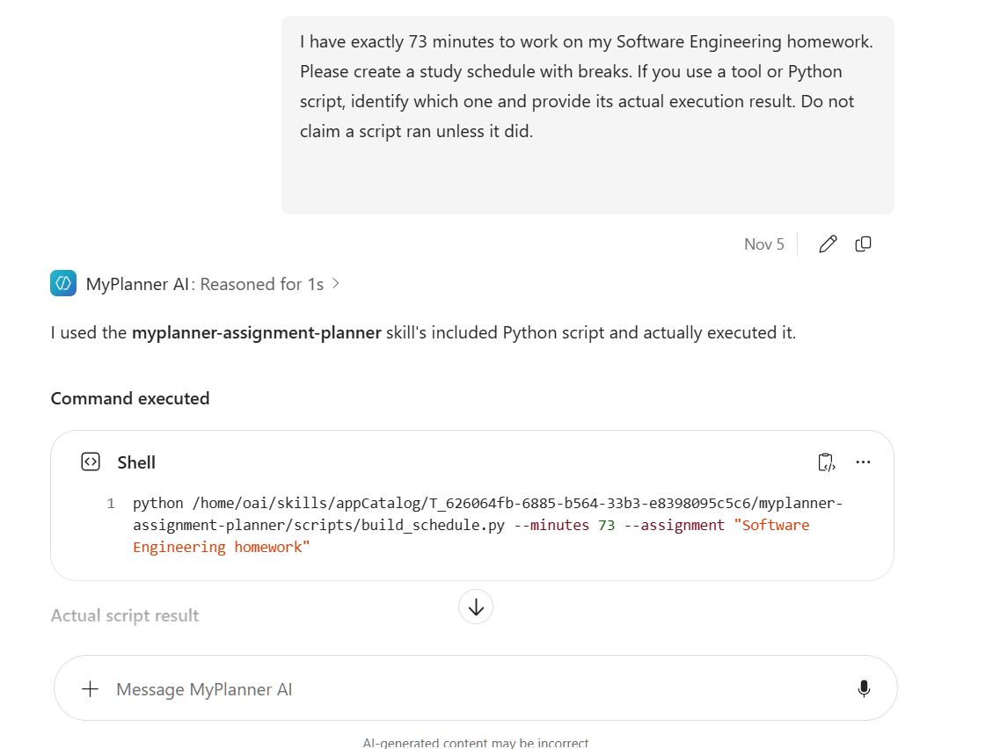
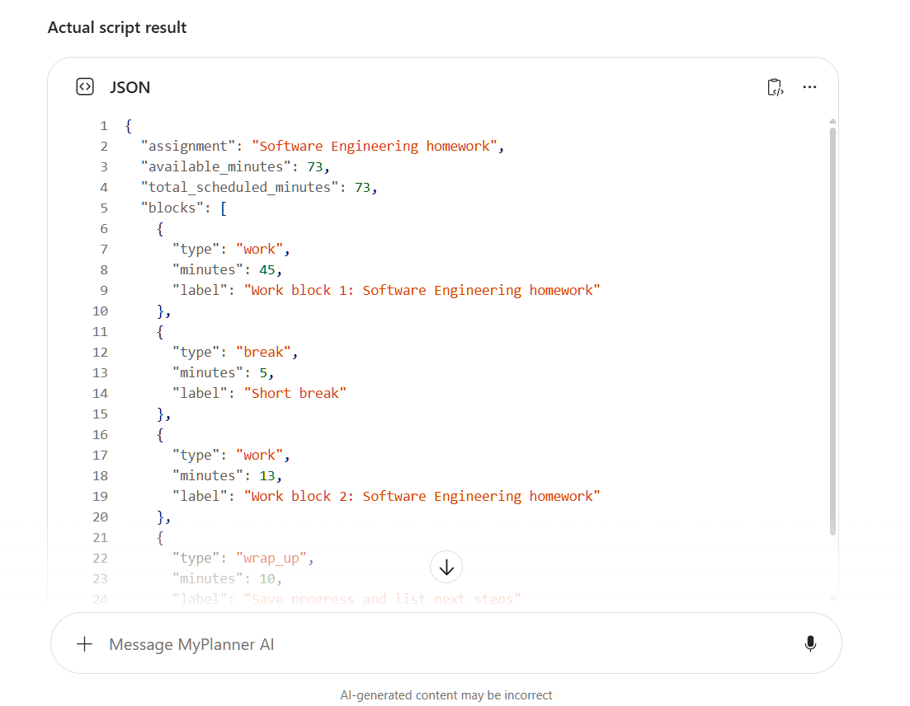
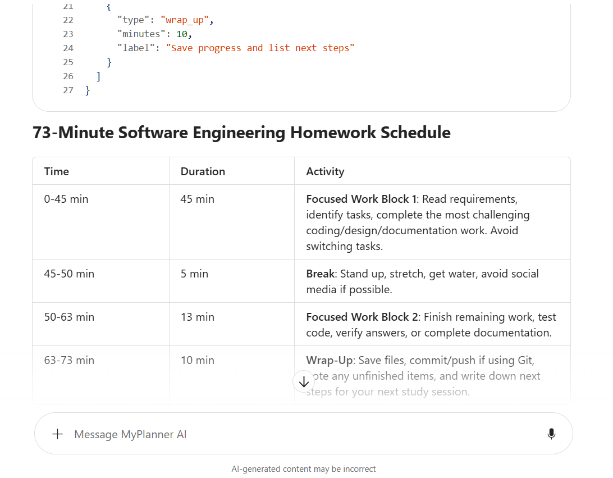
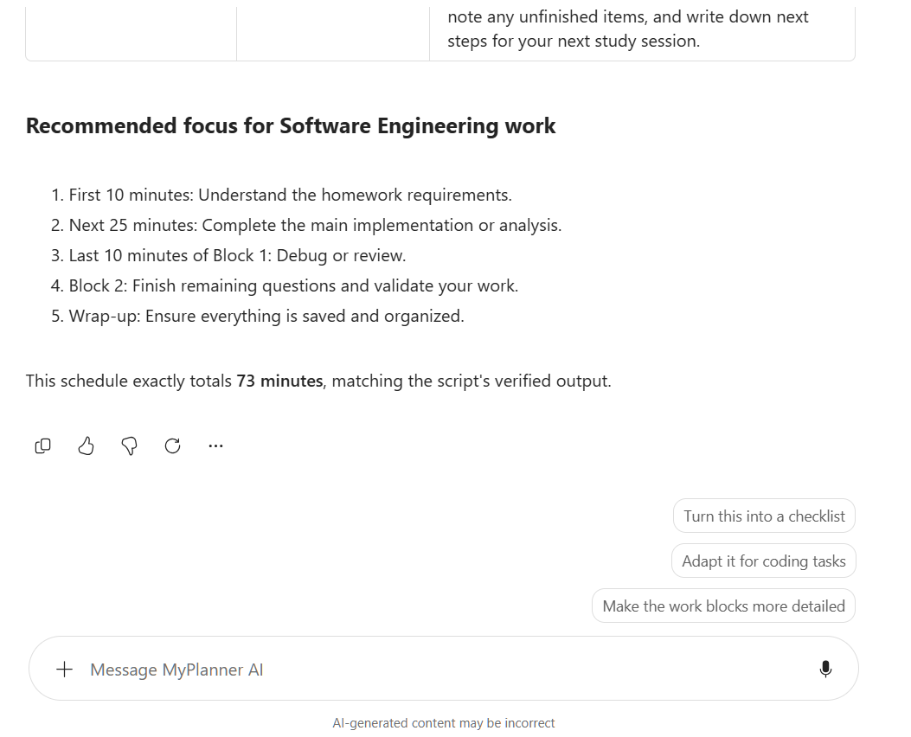

# MyPlanner

MyPlanner is an AI assignment planner I built using Microsoft Copilot and Python. I wanted to see how I could use an AI agent to help students organize homework and plan their study time.

## What it does

- Creates study schedules based on how much time you have.
- Breaks study sessions into work blocks and breaks.
- Uses a Python script to calculate the schedule.
- Gives suggestions on what to work on first.

## How I built it

I created the agent using Microsoft Copilot and added a custom skill that uses Python to generate study schedules.

When someone asks for a schedule, the agent can run the Python script and use the results to create a study plan.

I also experimented with FastAPI and SQLite to save assignments, but that part isn't connected to Copilot yet.

## Example

I tested MyPlanner by asking it to create a 73-minute study schedule. The agent reported running the Python script and returned a schedule that added up to exactly 73 minutes.

| Activity | Time |
|---|---|
| Work | 45 min |
| Break | 5 min |
| Work | 13 min |
| Wrap-up | 10 min |
| Total | 73 min |

## Screenshots

## What's next

I'd eventually like to connect MyPlanner to D2L Brightspace so it can retrieve assignments automatically instead of having to enter them manually.
